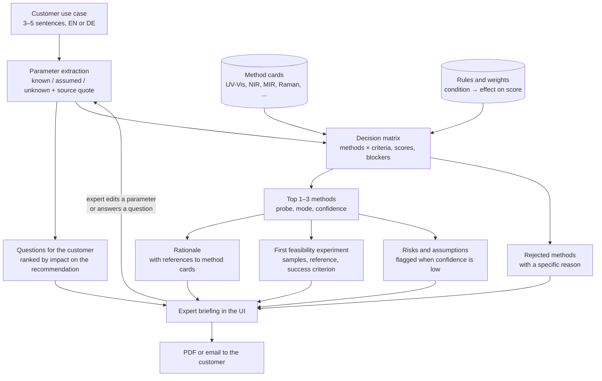

# Architecture (draft)

> Draft from team planning. Update after kickoff.

## Pipeline

## Design principles

- **Code scores, the LLM explains.** Method scores come from rules written by our chemist, so the same input always gives the same recommendation and the expert can see why each method got its score. The LLM reads the customer text and explains the finished result.
- **Rejected methods stay visible.** An AFS expert first checks whether something was dropped by mistake. Every rejected method shows a specific reason.
- **Recalculate on new information.** The first customer conversation is mostly clarification. Answering a question or editing a parameter updates the recommendation and shows what changed.

## Ownership

| Part | Folder | Owner |
|---|---|---|
| Prompts: parameter extraction, questions, rationale, experiment | `llm/prompts/` | Captain |
| API connecting all steps, deployment | `backend/` | Backend |
| Decision matrix, scoring, rejected methods, risks | `engine/` | Rules engine |
| Method cards / rules and weights | `kb/` / `rules/` | Chemist, rules engine |
| Test cases with expected answers | `data/test-cases/` | Chemist |
| Briefing UI, parameter editing, PDF export | `frontend/` | Frontend |
| Evaluation on test cases | `eval/` | Rules engine |
