# Decision paths (why this method)

Generated by `python -m engine.paths` from `rules/gates.yaml` on the golden attributes
(`eval/golden_cases.yaml`, written by hand, not a live extraction). D01-D08 = development,
H01-H06 = test. Each box lists the rules that decided the step; minor effects are only counted.

## H01 · New formulation after an existing NIR pilot

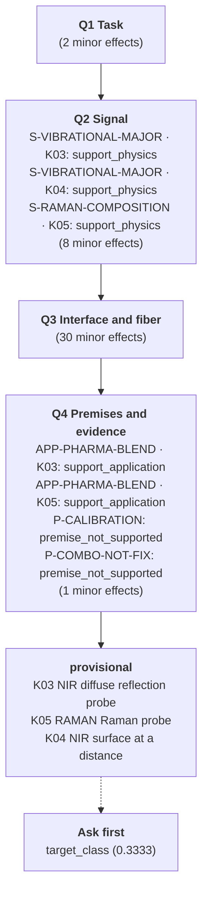

## H02-whey · Composition monitoring across two dairy streams

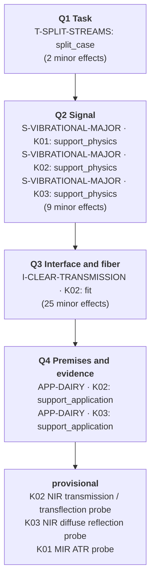

## H02-concentrate · Composition monitoring across two dairy streams

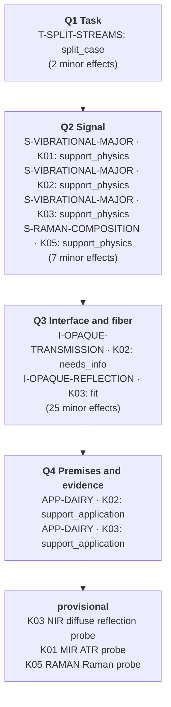

## H03-glucose · Fluorescence instrument requested for glucose and viable biomass

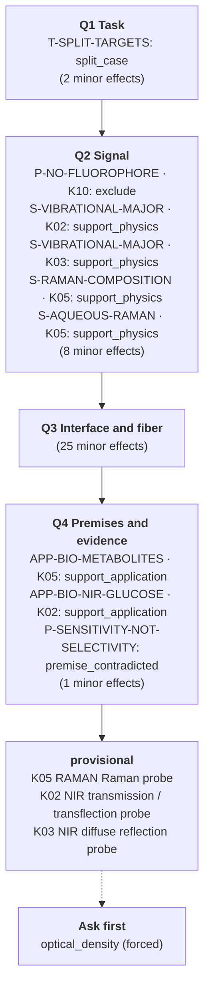

## H03-biomass · Fluorescence instrument requested for glucose and viable biomass

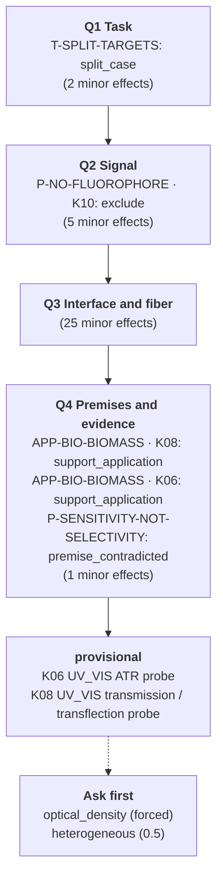

## H04 · Reuse of a silica link for petroleum MIR ATR

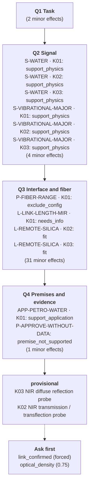

## H05 · Undefined off-specification liquid

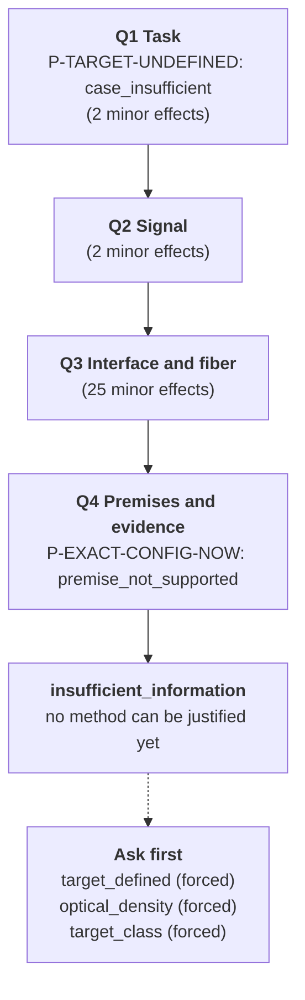

## H06 · Research sensor requested for immediate surgical use

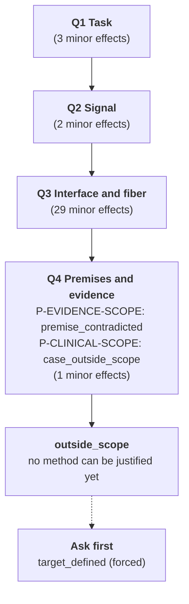

## D01 · Blend potency in a tablet press feed frame

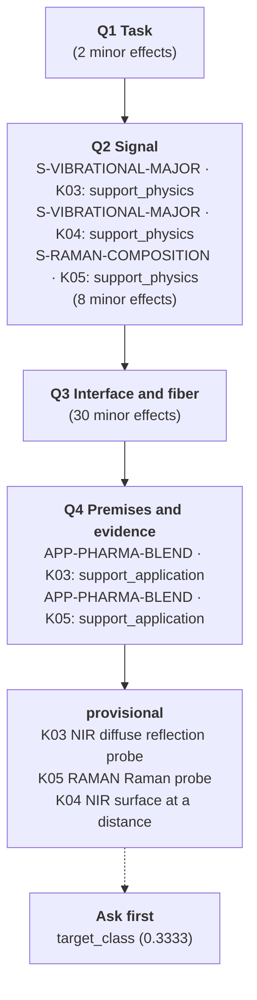

## D02-fat · Fat and protein in an opaque dairy product

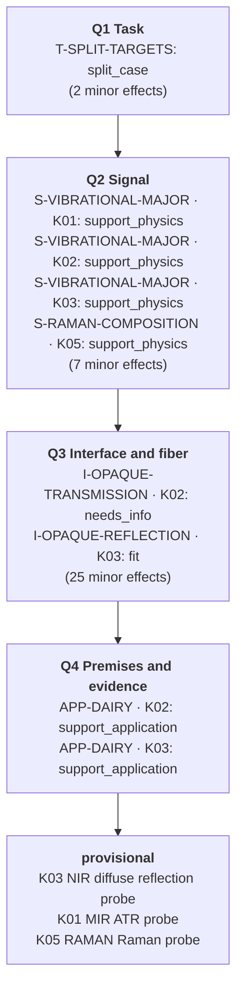

## D02-protein · Fat and protein in an opaque dairy product

## D03 · A clear whey stream that can become turbid

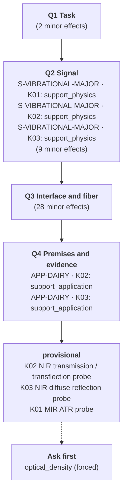

## D04-glucose · Glucose and lactate in an aqueous bioprocess

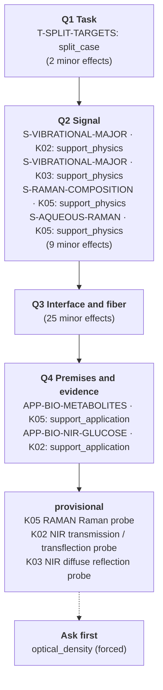

## D04-lactate · Glucose and lactate in an aqueous bioprocess

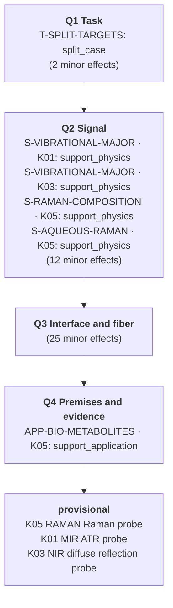

## D05-biomass · Biomass related monitoring during yeast fermentation

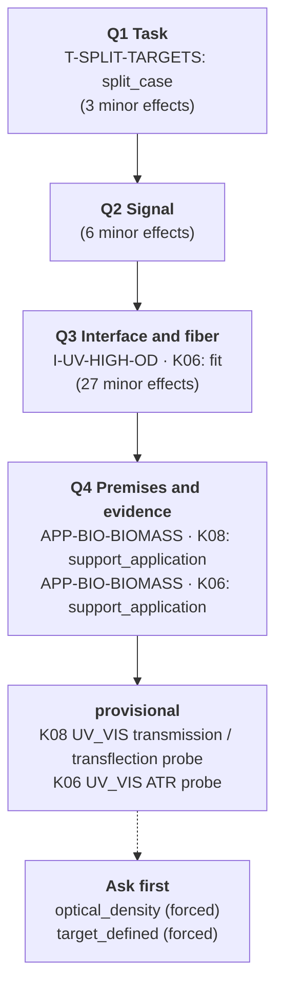

## D05-metabolic · Biomass related monitoring during yeast fermentation

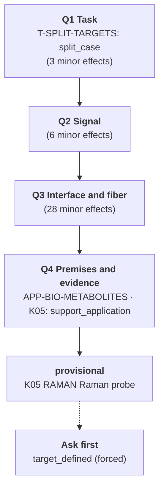

## D06 · Water content in a petroleum stream

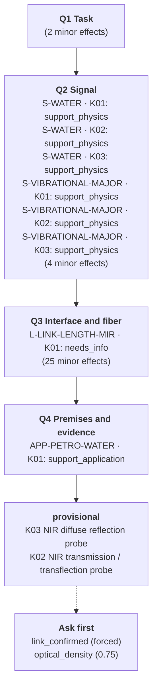

## D07 · API concentration during hot polymer extrusion

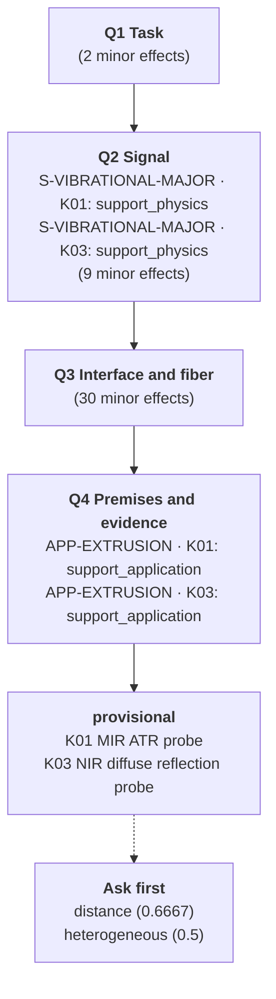

## D08 · Local measurements of heterogeneous model tissues

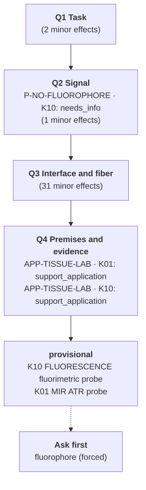
